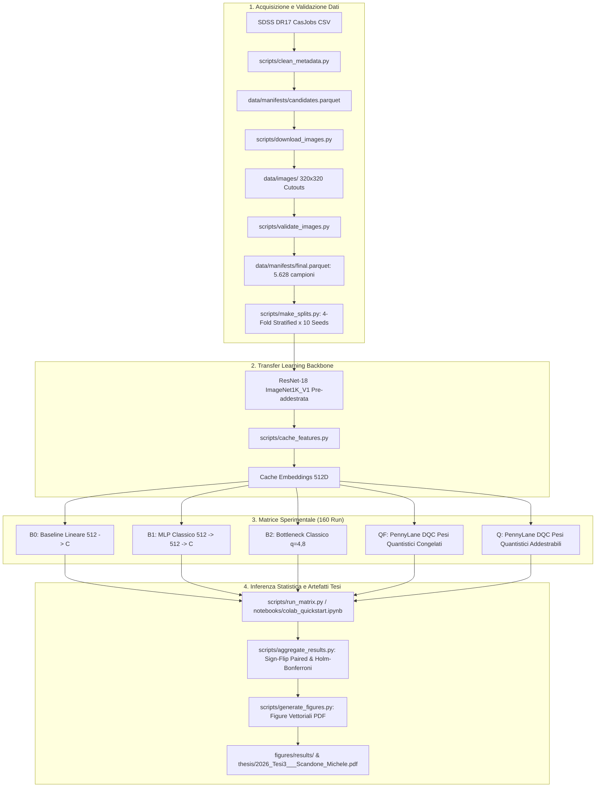

# Quantum Transfer Learning per la Classificazione delle Morfologie Galattiche

[](https://github.com/michelescandone/qtl-galaxy-classification/actions/workflows/ci.yml)
[](https://www.python.org/)
[](https://pytorch.org/)
[](https://pennylane.ai/)
[](https://opensource.org/licenses/MIT)

Repository ufficiale del progetto di tesi di laurea: **"Classificazione ibrida classico-quantistica delle morfologie galattiche: confronto tra bottleneck classici e circuiti quantistici variazionali"** (Università degli Studi di Torino).

Il progetto implementa una pipeline rigorosa e riproducibile per confrontare architetture classiche di Transfer Learning con **Dressed Quantum Circuits (DQC)** sviluppati in **PennyLane** e integrati con **PyTorch**, applicati alla classificazione morfologica di galassie da immagini SDSS DR17 / Galaxy Zoo.

---

## 🏛️ Struttura del Repository

La repo è organizzata come **monorepo modulare**, integrando codice scientifico, protocolli sperimentali, dati di controllo e documento finale della tesi di laurea in PDF:

```text
qtl-galaxy-classification/
├── src/tesi_qml/              # Pacchetto Python core (modelli, training, data pipeline, statistica)
├── scripts/                   # Script CLI eseguibili (dalla pulizia dati all'aggregazione finale)
├── configs/                   # Parametri bloccati YAML per dataset e addestramento
├── tests/                     # Suite completa di test Pytest (unitari, quantistici, integrazione)
├── notebooks/                 # Jupyter Notebook per audit dei dati e analisi dei risultati
├── docs/                      # Specifiche metodologiche, schemi di output e design sperimentale
├── data/                      # Manifest, partizioni Parquet e cataloghi sorgente SDSS
│   ├── manifests/             # Tabelle Parquet con audit, filtraggio e campioni finali
│   ├── splits/                # Partizioni stratificate 4-fold per 10 repeat seed
│   ├── source/                # Query CasJobs SDSS originale (GalaxyCandidates.csv)
│   └── images/                # Cutout 320x320 (scaricabili via script)
├── figures/                   # Figure vettoriali PDF e schemi utilizzati nella tesi
├── heat_map/                  # Modulo XAI (Grad-CAM per interpretabilità visiva)
├── thesis/                    # Documento completo della tesi di laurea in PDF
│   └── 2026_Tesi3___Scandone_Michele.pdf
├── pyproject.toml             # Configurazione del pacchetto Python ed entry points
├── requirements-cluster.txt   # Dipendenze con versioni bloccate per ambienti Linux/Cluster/GPU
├── requirements-colab.txt     # Dipendenze ottimizzate per Google Colab Pro
├── LICENSE                    # Licenza MIT per il codice sorgente
└── .gitignore                 # Regole per escludere checkpoint pesanti, cache e build
```

---

## 🔬 Metodologia e Disegno Sperimentale

Lo studio valuta se l'inserimento di un circuito quantistico parametrico addestrabile offra un vantaggio empirico rispetto a controparti classiche bilanciate per numero di gradi di libertà, sotto un rigoroso controllo dell'inizializzazione e delle partizioni.



### Task di Classificazione
- **`binary`**: `elliptical` ($0$) vs `spiral` ($1$). I merger vengono filtrati preservando gli split.
- **`three_class`**: `elliptical` ($0$), `merger` ($1$), `spiral` ($2$).

### Architetture a Confronto
Tutti i modelli impiegano una backbone **ResNet-18** (`IMAGENET1K_V1`) pre-addestrata e congelata ($512$ dimensioni in uscita):

| Sigla | Descrizione Architetturale |
|---|---|
| **B0** | Baseline lineare pura: $512 \to \text{Linear}(C)$ |
| **B1** | Multi-Layer Perceptron classico: $512 \to 512 \to \text{ReLU} \to \text{Dropout}(0.3) \to C$ |
| **B2-4/8** | Bottleneck classico non-lineare: $512 \to q \to \tanh \cdot \pi \to C$ ($q \in \{4, 8\}$) |
| **QF-4/8** | DQC PennyLane con **pesi quantistici congelati** e head lineare addestrabile |
| **Q-4/8** | DQC PennyLane con **pesi quantistici addestrabili** via backpropagation |

> **Controllo Sperimentale:** I modelli $B2$, $QF$ e $Q$ condividono la proiezione dimensionale e la head iniziale per ciascun task/seed/$q$. $QF$ e $Q$ condividono gli stessi pesi quantistici iniziali $\sim \mathcal{N}(0, 0.05^2)$.

### Matrice Sperimentale
La matrice primaria consiste in **160 run completi**:
$$\text{2 task} \times 10 \text{ repeat seed} \times \text{iteration}=1 \times 8 \text{ configurazioni}$$

L'inferenza statistica si basa su confronti bilaterali appaiati per seed ($n=10$) con:
- Test di permutazione con inversione di segno (sign-flip test)
- Bootstrap BCa / percentile al 95%
- Dimensione dell'effetto (Cohen's $d_z$)
- Controllo FWER mediante procedura Holm-Bonferroni

---

## ⚙️ Installazione e Setup

### Prerequisiti
- Python 3.10, 3.11 o 3.12
- PyTorch 2.x con supporto CUDA (opzionale ma consigliato per la feature extraction)
- PennyLane 0.42.3

### Creazione Ambiente Virtuale
```bash
# Clona il repository
git clone https://github.com/michelescandone/qtl-galaxy-classification.git
cd qtl-galaxy-classification

# Crea e attiva il virtual environment
python -m venv .venv
# Su Linux/macOS:
source .venv/bin/activate
# Su Windows (PowerShell):
.venv\Scripts\Activate.ps1

# Aggiorna pip e installa le dipendenze
python -m pip install --upgrade pip
python -m pip install -r requirements-cluster.txt

# Installa il pacchetto locale in modalità editabile con dipendenze dev
python -m pip install -e ".[dev]"
```

### Esecuzione della Suite di Test
```bash
# Esegui i test classici (143 test unitari e di integrazione)
pytest -m "not quantum" -q

# Esegui i test sui circuiti PennyLane (richiede dipendenza opzionale 'quantum')
pytest tests/quantum/test_pennylane_qnn.py -q

# Esegui i test del modulo XAI Grad-CAM
pytest heat_map/test_heatmaps.py -q
```

---

## 🚀 Riproduzione della Pipeline

### 1. Download e Preparazione del Dataset
I metadati e le assegnazioni dei fold sono già versionati in `data/manifests/` e `data/splits/`.
Per scaricare i cutout da SDSS DR17 e validarne l'integrità:

```bash
# 1. Pulisce i metadati originali
python scripts/clean_metadata.py --project-root .

# 2. Scarica le immagini dai server SDSS
python scripts/download_images.py --project-root .

# 3. Valida dimensioni, formati e hash delle immagini
python scripts/validate_images.py --project-root .

# 4. Genera il manifest sperimentale finale (5.628 campioni bilanciati)
python scripts/build_manifest.py --project-root .

# 5. Genera o verifica gli split stratificati
python scripts/make_splits.py --project-root .

# 6. Pre-computa la feature bank ResNet-18 (evita forward pass ripetuti)
python scripts/cache_features.py --project-root . --repeat-seed 42 --iteration 1 --device cuda
```

### 2. Addestramento di un Singolo Modello
```bash
# Esempio: Baseline classica B2 su task binario (4 qubit equivalenti)
python scripts/train.py --project-root . --task binary --model B2 --qubits 4 --repeat-seed 42 --iteration 1 --device cuda

# Esempio: Modello quantistico Q addestrabile su 3 classi con 8 qubit
python scripts/train.py --project-root . --task three_class --model Q --qubits 8 --repeat-seed 42 --iteration 1 --device cpu
```

### 3. Esecuzione della Matrice di Esperimenti
Il runner `run_matrix.py` supporta la ripresa automatica (`resume`) dei checkpoint e genera un registro atomico in `results/matrix/primary.json`:

```bash
# Dry-run per ispezionare i 160 task pianificati
python scripts/run_matrix.py --project-root . --dry-run

# Esecuzione controllata a lotti (es. 4 run alla volta)
python scripts/run_matrix.py --project-root . --max-runs 4 --device cpu

# Report dello stato di avanzamento
python scripts/run_matrix.py --project-root . --report-only
```

### 4. Statistica e Generazione Figure
```bash
# Calcola confronti appaiati, p-value Holm e intervalli bootstrap
python scripts/aggregate_results.py --project-root .

# Rigenera tutti i grafici della tesi in formato vettoriale PDF
python scripts/generate_figures.py --project-root .
```

### 5. Esecuzione su Google Colab e Campagna Subset
Per la riproduzione su Google Colab con accelerazione GPU e persistenza su Google Drive:
- Consultare la guida dettagliata: [`COLAB_GUIDE.md`](COLAB_GUIDE.md).
- Aprire il notebook unificato: [`notebooks/colab_quickstart.ipynb`](notebooks/colab_quickstart.ipynb).
- Per la campagna secondaria sui subset (100, 300, 900 campioni, 480 run): `python scripts/colab_subsets.py --help`.

---

## 📖 Tesi di Laurea (PDF)

Il documento completo e finale della tesi è disponibile direttamente in formato PDF:
- **[`thesis/2026_Tesi3___Scandone_Michele.pdf`](thesis/2026_Tesi3___Scandone_Michele.pdf)**

Comprende tutti i 7 capitoli di testo, le figure vettoriali dei risultati, le tabelle delle metriche e le appendici metodologiche (query CasJobs SDSS DR17 e codice di inferenza statistica appaiata).

---

## 📑 Citazione

Se utilizzi questo codice o i risultati della ricerca per i tuoi studi, puoi citare la tesi come segue:

```bibtex
@thesis{scandone2026qtl,
  author       = {Scandone, Michele},
  title        = {Classificazione ibrida classico-quantistica delle morfologie galattiche: confronto tra bottleneck classici e circuiti quantistici variazionali},
  school       = {Universit{\`a} degli Studi di Torino},
  year         = {2026},
  type         = {Tesi di Laurea Triennale in Informatica},
  note         = {Relatore: Prof. Luca Paolini}
}
```

---

## 📄 Licenza

- Il codice sorgente del repository è rilasciato sotto licenza [MIT](LICENSE).
- Il testo della tesi, i manifest e i dati aggregati sono rilasciati per scopi di riproducibilità scientifica e ricerca accademica under [Creative Commons Attribution 4.0 International (CC BY 4.0)](https://creativecommons.org/licenses/by/4.0/).
